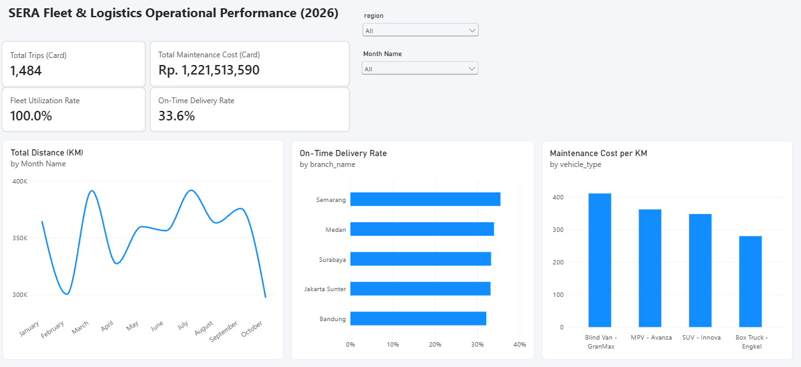
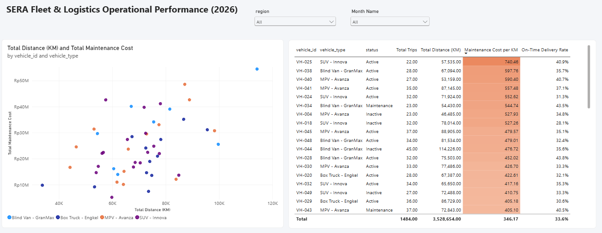

# Fleet Utilization & Logistics Operational Performance Dashboard (Microsoft Power BI)

**Description:** End-to-End Business Intelligence & Data Validation Portfolio  
**Interactive Video Demo:** [Portofolio MS Power BI](https://drive.google.com/drive/folders/17PM_8QqlDvCguQBtzCeM1et0oJsq7Ojz?usp=sharing)
**Repository:** [Lachrymousee/Power-BI-Portofolio](https://github.com/Lachrymousee/Power-BI-Portofolio)

### Tools & Technologies

- **Microsoft Power BI (Power Query, DAX, Data Modeling):** Pembersihan data (ETL), pemodelan relasional (_Star Schema_), dan visualisasi interaktif.
- **Python (Pandas, NumPy):** Pembuatan _sample dataset_ operasional dan simulasi _dirty data_.

---

## I. Business Context & Objective

Dalam operasional transportasi dan logistik dengan skala multi-cabang, manajemen sering menghadapi kendala visibilitas data terkait tingkat keterpakaian armada/kendaraan (_fleet utilization_), ketepatan waktu pengiriman (_On-Time Delivery_), serta biaya perawatan armada (_maintenance cost_).

Project ini bertujuan membangun sistem pelaporan interaktif menggunakan **Microsoft Power BI** yang dapat mengonsolidasikan data operasional mentah menjadi _insight_ strategis guna:

1. Memantau kinerja operasional harian dan bulanan lintas cabang regional secara _real-time_.
2. Mengevaluasi efisiensi biaya perawatan per kilometer armada berdasarkan tipe kendaraan.
3. Mendeteksi anomali unit armada yang mengalami inefisiensi biaya untuk mendukung keputusan audit dan peremajaan unit.

---

## II. Data Architecture & Validation

Untuk menjamin akurasi, integritas, dan konsistensi pelaporan, seluruh data mentah diproses melalui tahapan _Extract, Transform, Load_ (ETL) pada **Power Query** sebelum diproses menjadi bentuk visualisasi.

### 1. Data Cleansing & Validation

- **Deduplikasi Primary Key:** Mengidentifikasi dan menghapus catatan duplikat pada tabel armada (`dim_vehicle`) untuk mencegah perhitungan berulang dengan data yang sama.
- **Standardisasi Kategori:** Melakukan pembersihan spasi (_Trim_) dan penyeragaman huruf kapital pada atribut status operasional kendaraan (`Active`, `Maintenance`, `Inactive`).
- **Penanganan Nilai Kosong & Anomali:** Mengonversi nilai kosong (_null_) pada catatan biaya perawatan menjadi `0` serta menyaring keluar anomali pencatatan jarak tempuh bernilai negatif akibat kesalahan input sistem.
- **Validasi Tipe Data:** Memastikan seluruh kolom tanggal, numerik, dan mata uang memiliki tipe data relasional yang konsisten.

### 2. Data Modeling (Star Schema)

Merancang arsitektur **Star Schema** dengan memisahkan tabel transaksi operasional (`fact_operations` berisi **1.484 catatan bersih**) sebagai pusat skema yang terhubung melalui relasi _One-to-Many_ (`1:*`) ke tiga tabel dimensi:

- `dim_vehicle`: Profil 50 unit armada.
- `dim_branch`: Profil 5 cabang regional.
- `Dim_Date`: Tabel kalender dinamis berbasis _M-Language_.

---

## III. Key Metrics & DAX Implementation

Seluruh _Key Performance Indicator_ (KPI) dibangun menggunakan formula **Data Analysis Expressions (DAX)** yang terpusat dalam tabel `_Measures`:

- **Fleet Utilization Rate (%):** Mengukur rasio armada berstatus aktif yang beroperasi aktual terhadap total kapasitas armada aktif yang tersedia.
- **On-Time Delivery Rate (%):** Menghitung persentase pengiriman yang diselesaikan sesuai atau lebih cepat dari target waktu operasional (`actual_hours <= target_hours`).
- **Maintenance Cost per KM (IDR):** Mengukur rasio total biaya pemeliharaan terhadap total jarak tempuh armada untuk menstandarisasi evaluasi efisiensi antar tipe kendaraan.

---

## IV. Dashboard Overview & Key Analytical Findings

### A. Executive Operational Overview (Page 1)

- **Kinerja Keseluruhan:** Selama periode operasional Januari–Oktober 2026, tercatat total **1.484 perjalanan** dan _Total Maintenance Cost_ sebesar **Rp 1.221.513.590** dengan tingkat utilisasi armada mencapai **100,0%** dan rata-rata ketepatan waktu pengiriman sebesar **33,6%**.
- **Perbandingan Cabang:** Cabang **Semarang** (Region Jawa Tengah) mencatatkan performa ketepatan waktu tertinggi sebesar **35,5%**, sedangkan cabang **Bandung** (Region Jawa Barat) berada di posisi terendah sebesar **32,1%** sehingga memerlukan evaluasi alokasi rute.
- **Tren Jarak Tempuh Bulanan:** Grafik tren menunjukkan pergerakan jarak tempuh operasional yang berada di kisaran **300.000 KM – 390.000 KM** per bulan, di mana pengguna dapat memfilter performa spesifik berdasarkan wilayah (`region`) dan bulan (`Month Name`) secara dinamis.
- **Efisiensi Biaya Berdasarkan Tipe Armada:** Grafik perbandingan tipe kendaraan (_Maintenance Cost per KM by Vehicle Type_) mengungkap bahwa kategori **Blind Van - GranMax** memiliki beban biaya pemeliharaan tertinggi sebesar **Rp 411,37 / KM**, sedangkan kategori **Box Truck - Engkel** terbukti paling efisien dengan biaya **Rp 280,03 / KM**.

### B. Fleet Maintenance & Anomaly Audit (Page 2)

- **Deteksi Anomali Unit:** Melalui analisis grafik _Scatter Plot_ dan tabel audit berbasis _Conditional Formatting_, teridentifikasi **3 unit kendaraan** dengan rasio biaya perawatan per kilometer tertinggi yang menyimpang jauh dari rata-rata armada:
  1. **`VH-025`** (`SUV - Innova`): Biaya perawatan mencapai **Rp 740,46 / KM** dengan total jarak tempuh **57.535 KM**.
  2. **`VH-038`** (`Blind Van - GranMax`): Biaya perawatan mencapai **Rp 597,76 / KM** dengan total jarak tempuh **67.094 KM**.
  3. **`VH-040`** (`MPV - Avanza`): Biaya perawatan mencapai **Rp 590,40 / KM** dengan total jarak tempuh **53.159 KM**.

---

## V. Actionable Recommendations

Berdasarkan temuan data di atas, rekomendasi langkah operasional yang dapat diambil manajemen meliputi:

1. **Audit Teknis & Evaluasi Peremajaan Unit:** Memprioritaskan inspeksi mekanis menyeluruh terhadap 3 unit dengan _Maintenance Cost per KM_ tertinggi (`VH-025`, `VH-038`, dan `VH-040`) untuk menentukan kelayakan perbaikan lanjutan atau penggantian unit.
2. **Optimasi Penjadwalan Cabang:** Melakukan peninjauan ulang estimasi waktu tempuh (`target_hours`) dan distribusi armada pada cabang dengan _On-Time Delivery Rate_ di bawah rata-rata regional (khususnya cabang Bandung).
3. **Otomatisasi Validasi Input:** Menerapkan aturan validasi langsung pada sistem operasional untuk mencegah masuknya nilai jarak tempuh negatif maupun inkonsistensi penulisan status unit sejak awal pencatatan.
